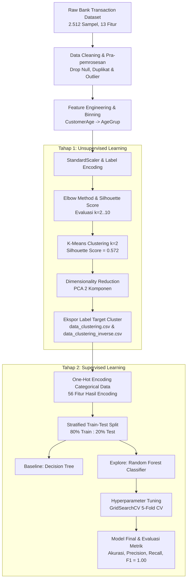

# 📊 Financial Transaction Pattern Analysis, Clustering & Classification

[](https://www.python.org/)
[](https://scikit-learn.org/)
[](https://pandas.pydata.org/)
[]()
[]()
[](LICENSE)

Proyek ini merupakan **Submission Akhir Kelas Belajar Machine Learning untuk Pemula (BMLP)** di platform **Dicoding Indonesia**, disusun oleh **Antonius Vincent Jung** ([@JayJung666](https://github.com/JayJung666)). 

Fokus utama proyek ini adalah menganalisis data transaksi perbankan untuk **Customer Segmentation (Profiling Nasabah)** menggunakan teknik *Unsupervised Learning* (K-Means Clustering & PCA), kemudian membangun sistem prediksi segmen nasabah menggunakan teknik *Supervised Learning* (Decision Tree & Random Forest dengan Hyperparameter Tuning GridSearchCV).

---

## 🎯 Ringkasan & Hasil Utama Proyek

### 1. Unsupervised Learning (Clustering)
- **Metode**: K-Means Clustering dengan evaluasi Elbow Method & Silhouette Analysis.
- **Skor Silhouette Optimal**: `0.572` pada $k = 2$.
- **Reduksi Dimensi**: Principal Component Analysis (PCA) 2 Komponen (`PCA1`, `PCA2`).
- **Segmen yang Dihasilkan**:
  - **Cluster 0 — Nasabah Senior Konservatif & Beraset Stabil**:
    - Usia rata-rata: **45.06 tahun** (Mayoritas kelompok usia sedang).
    - Rata-rata saldo akun: **$5,142.17** (Aset paling stabil).
    - Nilai transaksi rata-rata: **$255.55** dengan durasi lebih lama (**121.12 detik**), menunjukkan kehati-hatian dalam bertransaksi.
    - Dominasi Profesi: **Doctor**.
  - **Cluster 1 — Nasabah Muda Transaktif**:
    - Usia rata-rata: **44.33 tahun** (Mayoritas kelompok usia muda/rendah).
    - Rata-rata saldo akun: **$5,058.81**.
    - Nilai transaksi rata-rata lebih tinggi (**$258.15**) dengan durasi transaksi lebih cepat (**117.30 detik**), mencerminkan adaptabilitas tinggi terhadap transaksi digital instan.
    - Dominasi Profesi: **Student**.

### 2. Supervised Learning (Klasifikasi)
- **Target**: Memprediksi cluster nasabah (`Target`: 0 atau 1) dari fitur transaksi dan profil demografi hasil *One-Hot Encoding*.
- **Data Splitting**: Stratified Train-Test Split (80% Train : 20% Test) — 1.556 data latih & 389 data uji.
- **Hasil Evaluasi Model**:

| Model Algoritma | Akurasi | Precision (0 / 1) | Recall (0 / 1) | F1-Score | Status Kriteria |
| :--- | :---: | :---: | :---: | :---: | :---: |
| 🌲 **Decision Tree (Baseline)** | **100% (1.00)** | 1.00 / 1.00 | 1.00 / 1.00 | **1.00** | ✅ Passed |
| 🌳 **Random Forest (Explore Model)** | **100% (1.00)** | 1.00 / 1.00 | 1.00 / 1.00 | **1.00** | ✅ Skilled |
| ⚡ **Tuned Random Forest (GridSearchCV)** | **100% (1.00)** | 1.00 / 1.00 | 1.00 / 1.00 | **1.00** | ✅ Advanced |

---

## 🏗️ Alur Kerja Sistem (End-to-End ML Pipeline)



---

## 📁 Struktur Repositori

```text
belajar-machine-learning-pemula/
├── [Clustering]_Submission_Akhir_BMLP_Antonius_Vincent_Jung.ipynb   # Notebook proses clustering (K-Means & PCA)
├── [Klasifikasi]_Submission_Akhir_BMLP_Antonius_Vincent_Jung.ipynb  # Notebook klasifikasi (Decision Tree, RF & Tuning)
├── bank_transactions_data_edited.csv                              # Dataset transaksi bank mentah
├── data_clustering.csv                                            # Data hasil clustering (dalam skala standar)
├── data_clustering_inverse.csv                                    # Data hasil clustering (nilai asli / inverse scaled)
├── model_clustering.h5                                            # Model K-Means tersimpan
├── PCA_model_clustering.h5                                        # Model K-Means berbasis PCA tersimpan
├── decision_tree_model.h5                                         # Model Decision Tree tersimpan
├── explore_RandomForest_classification.h5                         # Model Random Forest baseline tersimpan
├── tuning_classification.h5                                       # Model Random Forest hasil tuning GridSearchCV
├── requirements.txt                                               # Daftar dependensi Python
├── .gitignore                                                     # File pengecualian Git
└── README.md                                                      # Dokumentasi lengkap proyek
```

---

## 🔬 Rincian Tahapan Eksperimen

### 1. Pembersihan dan Pra-pemrosesan Data
- **Pembersihan**: Menangani missing value dengan `dropna()`, menghapus duplikasi transaksi dengan `drop_duplicates()`, serta mitigasi data pencilan (*outliers*).
- **Seleksi Fitur**: Mengeliminasi kolom identitas dan waktu transaksi yang tidak relevan untuk pengelompokan pola perilaku finansial (`TransactionID`, `CustomerID`, `TransactionDate`, `DeviceID`, `IP Address`, `MerchantID`).
- **Feature Binning (Kriteria Advanced)**: Mengelompokkan usia nasabah (`CustomerAge`) menggunakan `pd.qcut` menjadi 3 kuantil (`rendah`, `sedang`, `tinggi`) dan menyimpannya sebagai fitur baru `AgeGrup`.
- **Standarisasi**: Normalisasi fitur numerik menggunakan `StandardScaler` dan konversi fitur kategorikal dengan `LabelEncoder`.

### 2. Segmentasi Nasabah (Clustering)
- Penentuan jumlah klaster terbaik dilakukan melalui visualisasi kurva *Inertia* dan *Silhouette Coefficient* menggunakan library **Yellowbrick (`KElbowVisualizer`)**. Nilai $k = 2$ terbukti memberikan separasi klaster paling optimal dan stabil.
- Reduksi dimensi dilakukan dengan **Principal Component Analysis (PCA)** menghasilkan bidang proyeksi 2 dimensi (`PCA1` dan `PCA2`), mempermudah visualisasi sebaran spasial kedua segmen nasabah.

### 3. Klasifikasi Profil Nasabah
- Dataset hasil clustering ditransformasikan ke bentuk fitur biner (*One-Hot Encoding*) untuk seluruh kolom kategorikal (`Channel`, `CustomerOccupation`, `AgeGrup`), menghasilkan representasi matriks 56 dimensi.
- Dilakukan perbandingan model:
  1. **Decision Tree Classifier (`random_state=42`)** sebagai baseline.
  2. **Random Forest Classifier (`n_estimators=100`)** sebagai model ensemble lanjutan.
  3. **GridSearchCV Hyperparameter Tuning** dengan ruang pencarian:
     - `n_estimators`: `[50, 100, 200]`
     - `max_depth`: `[None, 10, 20]`
     - `min_samples_split`: `[2, 5, 10]`
     - Evaluasi 5-Fold Cross Validation.

---

## 💻 Panduan Instalasi dan Menjalankan Proyek

### 1. Clone Repositori
```bash
git clone https://github.com/JayJung666/belajar-machine-learning-pemula.git
cd belajar-machine-learning-pemula
```

### 2. Buat & Aktifkan Virtual Environment (Disarankan)
```bash
# Windows
python -m venv venv
venv\Scripts\activate

# macOS / Linux
python3 -m venv venv
source venv/bin/activate
```

### 3. Install Dependensi
```bash
pip install -r requirements.txt
```

### 4. Menjalankan Jupyter Notebook
```bash
jupyter notebook
```
Buka notebook:
- `[Clustering]_Submission_Akhir_BMLP_Antonius_Vincent_Jung.ipynb` untuk eksplorasi unsupervised learning.
- `[Klasifikasi]_Submission_Akhir_BMLP_Antonius_Vincent_Jung.ipynb` untuk eksplorasi supervised learning.

---

## 💡 Contoh Memuat Model & Melakukan Inferensi

Anda dapat langsung memuat model yang telah dilatih menggunakan `joblib`:

```python
import joblib
import pandas as pd

# 1. Memuat model klasifikasi hasil tuning
model_rf = joblib.load('tuning_classification.h5')

# 2. Memuat data sampel uji
df = pd.read_csv('data_clustering_inverse.csv')
X = pd.get_dummies(df.drop('Target', axis=1))

# 3. Prediksi segmen nasabah
sample_prediction = model_rf.predict(X.iloc[:5])
print("Hasil Prediksi Cluster Nasabah:", sample_prediction)
```

---

## 👤 Profil Penulis

- **Nama**: Antonius Vincent Jung
- **GitHub**: [@JayJung666](https://github.com/JayJung666)
- **Email**: antoniusvincent09@gmail.com
- **Program**: Dicoding Indonesia — *Belajar Machine Learning untuk Pemula*

---

## 📜 Lisensi

Proyek ini didistribusikan di bawah lisensi MIT. Silakan merujuk ke file [LICENSE](LICENSE) jika tersedia untuk informasi lebih lanjut.
